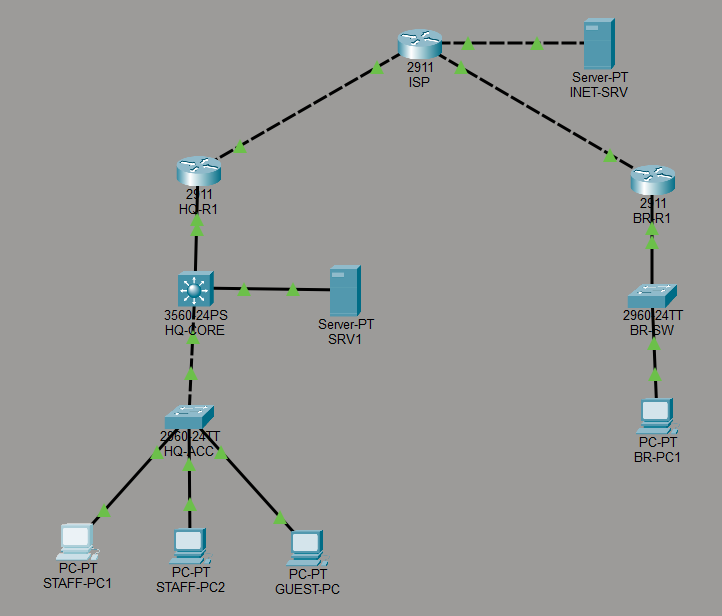
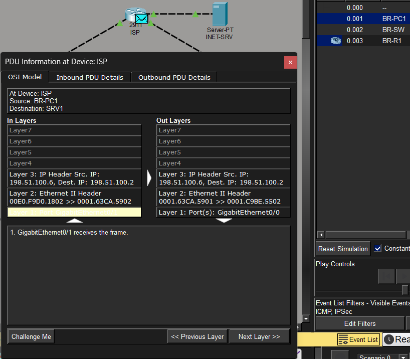

# Enterprise Network Lab: Head Office and Branch

A small company network built in **Cisco Packet Tracer**. It has a head office with VLANs, a Layer 3 core and OSPF, plus a branch office. Both sites reach the Internet through NAT and talk to each other over a **site-to-site IPsec VPN**.

## What it does

- **VLANs and inter-VLAN routing:** Staff, Servers, Guest and Management VLANs, routed on a Cisco 3560 multilayer switch (SVIs)
- **OSPF (area 0):** the core switch and the edge router exchange routes, and the edge router hands out the default route
- **DHCP:** central DHCP server on the edge router, relayed from each VLAN with `ip helper-address`; the branch has its own pool
- **NAT (PAT):** both sites share one public IP each to reach the Internet, and VPN traffic is excluded from NAT
- **Site-to-site IPsec VPN:** IKE phase 1 with AES-256 and a pre-shared key, IPsec phase 2 with ESP-AES / SHA; only head office ↔ branch traffic is encrypted
- **Security:**
  - The Guest VLAN gets Internet only, enforced by an ACL on the Guest gateway
  - SSH v2 only, limited to the Staff VLAN by a VTY access list
  - Port security with sticky MACs, PortFast and BPDU Guard on user ports
  - Unused ports parked in a shutdown VLAN; the native VLAN moved off VLAN 1; DTP turned off
- **Services and monitoring:** DNS, intranet web server and Syslog on SRV1; read-only SNMP on the edge router

## IP plan

| Network | Subnet | Gateway | Notes |
|---|---|---|---|
| VLAN 10 Staff | 10.10.10.0/24 | 10.10.10.1 | DHCP |
| VLAN 20 Servers | 10.10.20.0/24 | 10.10.20.1 | SRV1 = 10.10.20.10 |
| VLAN 30 Guest | 10.10.30.0/24 | 10.10.30.1 | DHCP, Internet only |
| VLAN 99 Management | 10.10.99.0/24 | 10.10.99.1 | HQ-ACC = 10.10.99.2 |
| Core ↔ edge link | 10.10.255.0/30 | – | HQ-R1 .1, HQ-CORE .2 |
| Branch LAN | 192.168.40.0/24 | 192.168.40.1 | DHCP |
| HQ WAN | 198.51.100.0/30 | – | ISP .1, HQ-R1 .2 |
| Branch WAN | 198.51.100.4/30 | – | ISP .5, BR-R1 .6 |
| "Internet" | 203.0.113.0/24 | 203.0.113.1 | INET-SRV = 203.0.113.10 |

VLAN 998 is the unused native VLAN, and VLAN 999 holds the parked unused ports.

## Verification

| Test | Result | Screenshots |
|---|---|---|
| Every PC gets an address from DHCP | ✔ | [Staff](screenshots/staff-pc-ipconfig.png) · [Guest](screenshots/guest-pc-ipconfig.png) · [Branch](screenshots/branch-pc-ipconfig.png) |
| Staff reach the intranet server (inter-VLAN routing + DNS) | ✔ | [Ping](screenshots/staff-ping-server.png) · [Web page](screenshots/staff-intranet.png) |
| Staff browse the Internet through NAT | ✔ | [Web page](screenshots/staff-internet.png) · [NAT table](screenshots/nat-translations.png) |
| Guest gets the Internet but is blocked from company networks | ✔ | [Web page](screenshots/guest-internet.png) · [Blocked ping](screenshots/guest-ping-blocked.png) · [ACL matches](screenshots/guest-acl-matches.png) |
| Branch reaches head office through the IPsec VPN | ✔ | [Ping](screenshots/branch-ping-hq.png) · [Intranet](screenshots/branch-intranet-vpn.png) · [IKE SA](screenshots/isakmp-sa.png) · [IPsec SA](screenshots/ipsec-sa.png) · [Encrypted packet](screenshots/vpn-packet-simulation.png) |
| OSPF neighbours are FULL and the default route is learned | ✔ | [Neighbour](screenshots/ospf-neighbor.png) · [Routing table](screenshots/core-routing-table.png) |
| SSH works from Staff and is blocked from Guest | ✔ | [Staff](screenshots/ssh-from-staff.png) · [Guest](screenshots/ssh-from-guest-blocked.png) |
| Port security learns sticky MACs | ✔ | [Port security](screenshots/port-security.png) |
| Router logs reach the Syslog server | ✔ | [Router](screenshots/show-logging.png) · [Server](screenshots/syslog-server.png) |

The IPsec counters show traffic going through the tunnel, and in Simulation mode the packet crossing the ISP only shows the two routers' public addresses (198.51.100.6 → 198.51.100.2):

## Design choices

- **The Layer 3 switch routes between VLANs,** so traffic between Staff and Servers never has to go up to the router.
- **The Guest ACL sits inbound on the Guest gateway (VLAN 30).** That blocks guest traffic as early as possible, but still lets DHCP through.
- **NAT skips VPN traffic.** Otherwise head office ↔ branch packets would be translated before the VPN sees them, and the tunnel would never match.
- **The ISP router has no routes to private addresses,** just like a real provider. So Internet access only works through NAT, and branch ↔ head office only works through the VPN.

## Files

- `enterprise-network-lab.pkt`: the Packet Tracer file
- `configs/`: the full configuration of every network device, with comments
- `BUILD_GUIDE.md`: how to rebuild the lab from scratch
- `screenshots/`: test results

## Next steps

- Run OSPF to the branch through a GRE tunnel protected by IPsec, so the branch learns routes dynamically
- Monitor real devices with Zabbix over SNMP

*All passwords and keys in this lab are for the lab only.*
